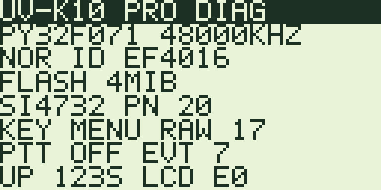

# UV-K10 Pro 实验固件

[](https://github.com/guanzi008/uv-k10pro-firmware/actions/workflows/ci.yml)

基于泉盛 **UV-K10 Pro 官方英文固件 8.02.16 的静态分析、原指令仿真和官方应用配置交叉核对**，独立实现的第三方固件与研究工程。当前固件版本 `0.2.0-exp` 面向开发者进行硬件初始化与诊断，目标平台为 PY32F071 Cortex-M0+，采用 128 KiB Flash / 16 KiB SRAM 地址布局。设备所有者已确认 MCU 系列及外置 25Q32 密度等级：**32 Mbit = 4 MiB = 4,194,304 字节**；完整器件后缀和板号仍未记录。

**当前没有实机启动、屏幕显示或收发验证记录，不能当作日常对讲固件使用。** 本仓库已经实现可构建的启动程序、硬件驱动、显示/按键诊断应用及固件文件工具；可导航的完整菜单、对讲接收与发射、GPS/APRS、USB 通信和恢复刷写流程仍待开发。软件通过编译和主机测试，不等于设备已验证。

## 已实现的内容

| 模块 | 当前实现 | 验证边界 |
|---|---|---|
| 启动与链接 | 48 项向量表、RAM 初始化、VTOR、弱中断处理、Flash/RAM 链接断言 | 主机检查和交叉编译；无实机启动证据 |
| MCU HAL | 解析继承的 RCC 时钟、SysTick、延时、128 位 UID、空闲等待 | 未测量实机时钟；未知时钟有状态标志 |
| 外部 SPI NOR | SPI2 模式 3、PA0/1/2 + PA3 CS、JEDEC 识别、带容量边界的读取 | 驱动未连接实机；不含写入/擦除 API |
| Si4732 | PB8/PB9 软件 I²C、POWER_UP、GET_REV、超时/NACK 处理、可选 FM 调谐与读回核对 | 需要芯片已供电并释放 RESET；音频线路待核对 |
| LCD / RGB 背光 | SPI1、128×64 单色页格式、列偏移 +4、三路 PWM、完整初始化/清屏/刷新 | 真实原厂函数重放与独立 C 驱动测试；具体控制器和排线针序待实物确认 |
| 按键 / PTT | 4 行 × 5 列中的 19 个键位、3 个专用键、PC13 独立 PTT、20 ms 诊断去抖 | 默认关闭矩阵以不主动接管 PA14/SWCLK；只报告输入，未实现菜单/长按动作 |
| 诊断应用 | 128×64 状态页、独立帧缓冲、ABI 2 RAM 状态、GDB 命令邮箱、64 字节 Flash 读取 | 显示主机合成输入已检查；无实机显示或 USB/串口控制台 |
| 固件工具 | XOR128 + CRC16/XMODEM 封装、解包、检查、SHA-256 | 官方样本重封装逐字节一致；未验证官方刷写器接收新包 |
| 信道工具 | 999 个普通信道、14 个 VFO、属性表、亚音、名称、扫描列表的离线解析与编辑 | 实际原厂加载/保存/删除函数重放；保留未知字节；不连接设备 |
| 写频协议 | 帧编解码、CRC16/X25、XOR16、原始 Flash 读写请求草稿与状态模型 | 原厂 parser→dispatcher→sender，另有合成 NOR 写入再读回；没有在线写频程序 |
| 仿真与设置地图 | 固定样本的 CPU 重放、4 KiB NOR 更新、RF GPIO 位流、APK schema 摘要/版本比较 | 明确的人工输入与外设模型；APK 声明和固件行为分别标记 |
| 型号隔离 | K8 / K82 / UV5 分别审计、CPS 产品资源与实际转换调用链、参数版本回复 | 不把相似名称或参数版本 0 当作唯一设备 ID；完整 Dart 动态路由尚未恢复 |
| 自动化 | Python 单元测试、驱动模拟、ARM 构建、向量/大小检查、开发构建产物 | GitHub Actions 不接触硬件 |

引脚、寄存器及固件内函数位置见 [引脚证据](docs/pinmap.md)，芯片判定和样本来源见 [逆向记录](docs/reverse-engineering.md)。用户确认、厂商规格、样本执行与未验证项分别记录在[型号审计](docs/model-identity.md)中，不将用户确认改写为新的实机测量。

各版本本地验证结果、工具链、镜像大小、摘要和测试覆盖见 [验证记录](docs/validation.md)。

## 独立 Web 写频项目

浏览器写频工作台另建于 **[uv-k10pro-web](https://github.com/guanzi008/uv-k10pro-web)**，不与 MCU 固件混在一个发布包中。它实现普通信道、VFO、Si4732/BK1080 存台、设置、扫描、联系人、开机图和本地备份，包含 Web Serial / WebUSB / 显式配置 BLE、正常密码认证、写前基线核对、备份及写后回读。实际设备验收与可写边界以该仓库说明为准；本仓库 Python 原型工具不会因此自动变成在线写频器。

该项目继续执行官方广播 loader/saver 与正常密码验证指令，发现并修正当前 CPS 的若干结构和枚举差异。机主新补充的音频功放标识 **4898** 也已收入[硬件表](docs/hardware-research.md)，完整厂商/后缀/引脚待核，不擅自指定为 LM4898。

## 显示、按键与型号审计进展

屏幕使用 **PA5/AF0 SCK、PA7/AF0 MOSI、PB2 CS#、PF2 D/C**；RGB 背光分别为 **PB6/TIM1_CH3、PA15/TIM2_CH1、PB5/TIM3_CH2**。原厂初始化、页寻址、RGB 设置到 PWM 的路径已执行验证，详见 [显示研究与驱动](docs/display.md)。这里的 RGB 指背光；帧缓冲是 1 bit/pixel。ST7565/ST7567 兼容命令不能单独确定唯一控制器型号。

矩阵行是 **PF8、PB4、PB3、PA14**，列是 **PB15、PB14、PB13、PB12、PA8**。完整键码表、数字/菜单/返回/上下/A-B/锁定语义、侧键短长按与 PTT 去抖，见 [按键研究](docs/keypad.md)。原厂的 53 个按键执行案例和 14 个显示/PWM 执行案例保存在可重生成 JSON 中。

Android 包确实包含多个型号分支：本项目仅采用 **K8 的 999×64 B** 路径，排除 K82 的 200×16 B 和 UV5 的独立布局。CPS 的 `K7` 是程序集内部命名，产品资源和实际 UI 是 UV-K10 Pro。原厂四项 `FM/AM/SSB/CW` 与 CPS/K8 三项列表的差异已追到实际转换调用链，不能用另一机型的枚举填平；详见[型号隔离与调用路径审计](docs/model-identity.md)。

本轮还纠正旧版文档的 SPI2 信号名称：**PA1 是 MOSI，PA2 是 MISO**，依据 Puya 同型号手册的引脚表和 AF 表。两脚都为 AF9，原有寄存器配置不变；连接硬件时应采用修正后的名称。

## 信道与协议研究进展

普通信道记录为 **64 B × 999**，地址 `index * 64`；属性字节位于 `0x11000 + index`。接收频率和频差均使用 10 Hz 单位，删除操作只将属性置 `FF`。这些行为由原厂函数执行验证，详细字段和版本差异见 [信道与扫描列表](docs/channel-storage.md)。

电脑写频使用通用存储命令 `0x02C3` 读、`0x02C5` 写；USB 为固件中声明的 CDC ACM，VID/PID `36B7:0001`。**写入 ACK 可能对应被状态门控跳过的操作**，USB/USART1 回应中的 `FFFF` 也不是计算出的 CRC。完整帧格式、状态条件和证据见 [写频协议](docs/programming-protocol.md)。

原厂 NOR 更新函数有两种擦除后行为，不能仅凭请求的地址/长度推断副作用。原厂 RF 三线函数已经执行到 GPIO 逻辑边沿，得到 PF5 SCK、PF6 双向 SDATA、PF9 低有效 CS；芯片具体型号仍待丝印确认。模型、可复现命令和每项边界见 [仿真记录](docs/emulation.md)。

官网 APK 的协议机型为 K8。静态配置覆盖全局设置、DTMF、五音、APRS、广播存台和开机图等区域，但部分枚举与当前固件不同，且 APRS 声明存在重叠字段。参见 [设置地址图与应用版本差异](docs/settings-map.md)、[硬件资料与拆机线索](docs/hardware-research.md)。

官方 PC CPS 0.56 的实际程序也已从安装包静态提取并分析 .NET 元数据/IL。它进一步确认了 64 B 信道结构，并纠正了写请求的内层长度含义：CPS 使用固定 12 B 头长度及 128 B 数据槽，count 可以小于数据槽长度。独立分析工具为 [analyze_cps.py](tools/analyze_cps.py)，报告见 [CPS 交叉证据](docs/evidence/cps-protocol-crosscheck.json)。

## 构建

需要 GNU Make、Python 3.10+、Arm GNU `arm-none-eabi` 工具链，以及用于驱动模拟测试的主机 C 编译器。普通文件与协议工具仅使用 Python 标准库；原指令仿真另需 [requirements-re.txt](requirements-re.txt) 中的可选依赖。本地验证采用 Arm GNU Toolchain **14.3.Rel1 / GCC 14.3.1**；CI 使用 Ubuntu 提供的 GCC ARM Embedded。

```sh
git clone https://github.com/guanzi008/uv-k10pro-firmware.git
cd uv-k10pro-firmware
make test
make -j2 verify
make package
```

若工具链未在 PATH 中：

```sh
make CROSS_COMPILE=/absolute/path/to/bin/arm-none-eabi- package
```

默认开启 NOR、Si4732 和显示驱动；键盘默认关闭，以不主动接管 PA14/SWCLK。
需要构建输入诊断版本时，显式选择：

```sh
make BUILD=build-keypad EXTRA_CPPFLAGS=-DK10_ENABLE_KEYPAD=1 package
```

这个选项会把 PA14 设为矩阵输出。它只是构建选项，不会刷机。四项 `K10_ENABLE_*` 均支持设为 0，此时对应驱动无 MMIO。关闭键盘只保留该脚继承状态，不保证任意启动环境下 SWD 已经可用。

`build/k10pro.elf` 保留调试符号；`build/k10pro.bin` 是原始应用镜像；`build/k10pro.experimental.bin` 是实验性更新容器。`build/verification.json` 和 `build/package.json` 记录结构检查与 SHA-256。这些命令只构建本地文件。

应用起点为 `0x08002000`。本工程把应用 Flash 上界保守设为 `0x0801F000`，保留前 8 KiB 地址范围与最后 4 KiB；RAM 为 `0x20000000..0x20003FFF`。**这是链接范围约束，不能保证一个尚未验证的刷写器如何擦除 Flash。** 没有提供一键刷入脚本。

## 诊断应用怎样使用

程序启动后读取 MCU UID，初始化 LCD，并在成功后请求 RGB 背光各 25。随后读取外部 Flash JEDEC ID；只有识别到明确支持的型号才读取 Flash 前 64 字节，再尝试初始化 Si4732 并读出版本。诊断屏每 250 ms 更新。缺少芯片、总线未响应或型号未知会记录错误码，应用仍进入诊断循环。LCD 为只写接口，SPI 本地成功不证明已经接上屏幕。

下面是**同一 C 渲染器对合成测试输入的输出**，用于检查布局；不是实机照片，JEDEC、PN、按键和运行时间均为示例：



状态保存在 ELF 符号 `k10_diag` 对应的 RAM 中。ABI 2 增加显示帧数、显示/按键错误、原始和稳定键码、独立 PTT 状态、输入事件和预期容量；ABI 1 原字段的偏移保持不变。4 MiB 预期值不会替代 JEDEC 识别。启用矩阵时每 10 ms 尝试扫描，独立诊断过滤器采用 20 ms 稳定条件，尚未复刻原厂长按/重复/菜单状态机。原厂 USB 和串口参数目前用于研究，尚未实现到这份诊断应用。

在**已建立的、经过核实的调试连接**上加载与当前程序匹配的 ELF 符号后，可暂停目标读取：

```gdb
p/x k10_diag
p k10_diag.stage
p/x k10_diag.jedec_id
p k10_diag.flash_capacity_bytes
x/64bx &k10_diag.buffer
```

支持重新探测、受限 Flash 读取和显式 FM 调谐命令。具体握手和字段说明见 [调试接口](docs/debugging.md)。仓库未确认 SWD 焊盘、板级 RESET/供电控制及 bootloader 恢复操作，文档不会把未核实的接线写成操作步骤。

## 分析自己下载的官方固件

从[厂商产品页](https://qsfj.com/products/11145)获取相应版本，保存在被忽略的 `reference/` 目录中：

```sh
python3 tools/fwtool.py inspect reference/K10PRO_ENG_v8.02.16_publish.bin
python3 tools/fwtool.py unpack reference/K10PRO_ENG_v8.02.16_publish.bin reference/stock.raw.bin
K10_REFERENCE_FIRMWARE=reference/K10PRO_ENG_v8.02.16_publish.bin make test
```

普通测试不依赖官方文件，参考样本测试在未提供路径时跳过。参考包的 SHA-256、解码后的 SHA-256、版本及 CRC 均有固定断言。容器格式见 [格式说明](docs/container-format.md)。官方文件、反汇编、外部 Flash 数据和 Si47xx 补丁均未随仓库发布。

安装可选依赖后可执行原厂函数，并启用实际样本测试：

```sh
python3 -m pip install -r requirements-re.txt
python3 tools/emulate_channels.py reference/stock.raw.bin
python3 tools/emulate_programming.py reference/stock.raw.bin --output protocol-results.json
python3 tools/emulate_storage.py reference/stock.raw.bin --output storage-results.json
python3 tools/emulate_rf_bus.py reference/stock.raw.bin --output rf-results.json
python3 tools/emulate_display.py reference/stock.raw.bin --output display-results.json
python3 tools/emulate_keypad.py reference/stock.raw.bin --output keypad-results.json
K10_REFERENCE_FIRMWARE=reference/K10PRO_ENG_v8.02.16_publish.bin \
  K10_REFERENCE_RAW=reference/stock.raw.bin make test
```

### 离线读取与编辑信道

这里需要**外部 NOR 配置转储**，不能把 MCU 更新包当成信道文件。工具中的索引从 0 开始，索引 77 对应界面信道 78。示例只生成本地文件和帧草稿：

```sh
python3 tools/channel_codec.py inspect radio-nor.bin --index 77
python3 tools/channel_codec.py patch radio-nor.bin edited-nor.bin --index 77 \
  --name TEST --rx-hz 145525000 --offset-hz 600000 --set offset_direction=1
python3 tools/programming_protocol.py draft-read 0x1340 64 \
  --session 0x12345678 --transport 1 --xor
python3 tools/inspect_vendor_schema.py /path/to/official.apk
```

例中的 session 是人工示例值。工具没有自动会话、在线下载、刷入或发射功能。修改频段时还需核对独立属性与设备的动态频段配置，不能只替换频率数字。

## 接下来需要补齐的设备能力

1. 在已确认 MCU 系列与 25Q32 容量的基础上，补完整丝印后缀、板号、SWD、供电/复位、晶振与 bootloader 交接状态，取得可恢复的实机启动记录。
2. 核验已恢复的 LCD 总线、初始化、RGB 和矩阵；补排线针序、控制器唯一型号、实际像素方向和键帽位置，再实现可导航菜单。
3. 确认主对讲射频芯片、音频开关、校准数据结构，完成接收路径。
4. 在设备测量与校准资料齐全后开发发射控制；随后再处理 GPS/APRS、USB、设置保存和稳定更新流程。

详细可验证的里程碑见 [开发路线](docs/roadmap.md)。当前已知证据不足以把其他 UV-K1 / UV-K5 V3 工程直接当作 K10 Pro 固件。

## 许可证与来源

新编写的代码与文档使用 [MIT](LICENSE) 许可证。实现参考公开硬件文档与官方固件行为观察；这不是隔离团队的 clean-room 声明。第三方参考资料及商标不受本仓库 MIT 许可证授权，见 [NOTICE](NOTICE)。

## English summary

An independently written, experimental UV-K10 Pro firmware and research project targeting the owner-confirmed PY32F071 family and 25Q32-density NOR, with the Cortex-M0+ application at `0x08002000`. Version 0.2.0-exp adds a 128x64 monochrome LCD/RGB driver, optional keypad/PTT diagnostics and a rendered status page to the runtime, read-only NOR and Si4732 drivers, debugger mailbox, channel/protocol tools and CI. Stock-instruction replay now includes LCD, PWM, key filtering and selected UI semantics. APK K8/K82/UV5 paths and the actual K10 CPS are audited separately. No vendor firmware, APK, complete vendor schema or receiver patch is redistributed. Physical boot, display/input behavior, transceiver operation and updater acceptance remain unvalidated.
